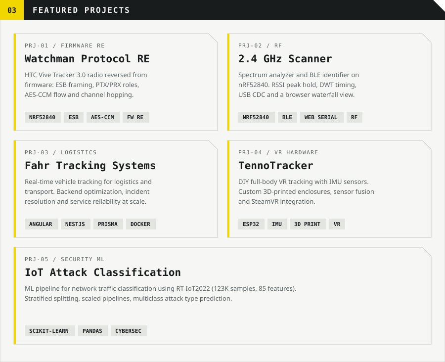

<picture><source media="(prefers-color-scheme: dark)" srcset="./imgs/endfield/dark/header.svg"></picture>

<picture><source media="(prefers-color-scheme: dark)" srcset="./imgs/endfield/dark/whoami.svg"></picture>

<picture><source media="(prefers-color-scheme: dark)" srcset="./imgs/endfield/dark/experience.svg"></picture>

<picture><source media="(prefers-color-scheme: dark)" srcset="./imgs/endfield/dark/projects.svg"></picture>

<picture><source media="(prefers-color-scheme: dark)" srcset="./imgs/endfield/dark/stack.svg"></picture>

<picture><source media="(prefers-color-scheme: dark)" srcset="./imgs/endfield/dark/background.svg"></picture>

<picture><source media="(prefers-color-scheme: dark)" srcset="./imgs/endfield/dark/s-contact.svg"></picture>

  <a href="mailto:johntenno117@hotmail.com"><picture><source media="(prefers-color-scheme: dark)" srcset="./imgs/endfield/dark/c-email.svg"></picture></a>
  <a href="https://www.linkedin.com/in/jonathan-gandara-1191aa267/"><picture><source media="(prefers-color-scheme: dark)" srcset="./imgs/endfield/dark/c-linkedin.svg"></picture></a>
  <a href="https://discordapp.com/users/583377862870958085"><picture><source media="(prefers-color-scheme: dark)" srcset="./imgs/endfield/dark/c-discord.svg"></picture></a>

