<picture><source media="(prefers-color-scheme: dark)" srcset="./imgs/endfield/dark/header.svg">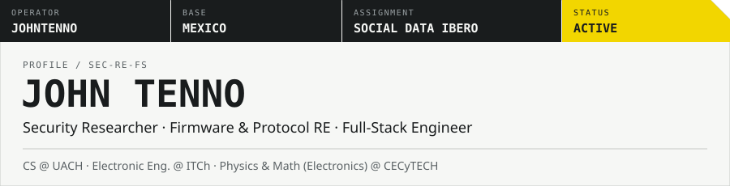</picture>

<picture><source media="(prefers-color-scheme: dark)" srcset="./imgs/endfield/dark/whoami.svg">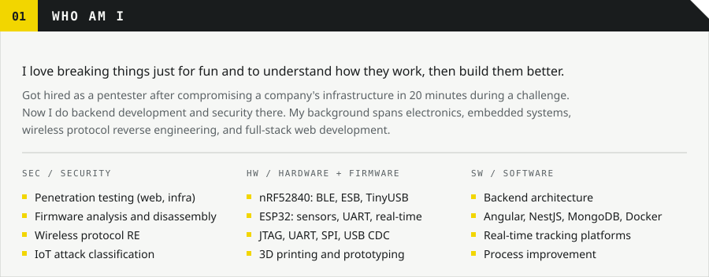</picture>

<picture><source media="(prefers-color-scheme: dark)" srcset="./imgs/endfield/dark/experience.svg">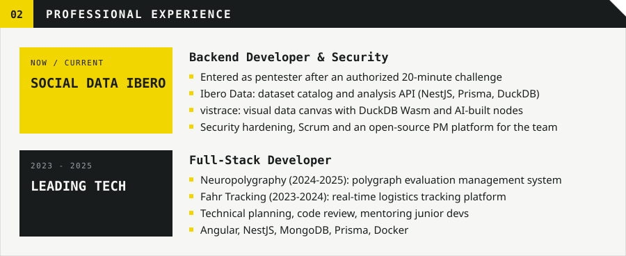</picture>

<picture><source media="(prefers-color-scheme: dark)" srcset="./imgs/endfield/dark/s-projects.svg"></picture>

  <a href="https://github.com/JohnTenno/nRF52840-2.4GHz-Spectrum-Analyzer"><picture><source media="(prefers-color-scheme: dark)" srcset="./imgs/endfield/dark/p-scanner.svg">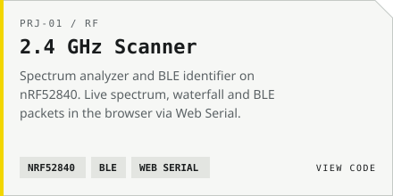</picture></a>
  <picture><source media="(prefers-color-scheme: dark)" srcset="./imgs/endfield/dark/p-watchman.svg">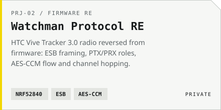</picture>
  <a href="https://github.com/JohnTenno/lighthouse-manager-quest"><picture><source media="(prefers-color-scheme: dark)" srcset="./imgs/endfield/dark/p-lighthouse.svg">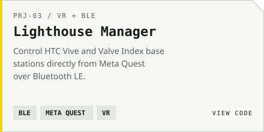</picture></a>
  <a href="https://github.com/JohnTenno/ESP32-GUITARHERO-UART"><picture><source media="(prefers-color-scheme: dark)" srcset="./imgs/endfield/dark/p-guitar.svg">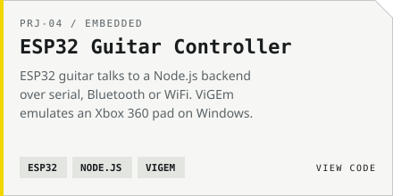</picture></a>
  <a href="https://github.com/JohnTenno/claude-watchOS"><picture><source media="(prefers-color-scheme: dark)" srcset="./imgs/endfield/dark/p-watch.svg">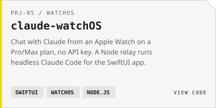</picture></a>
  <a href="https://github.com/JohnTenno/TouchBarStats"><picture><source media="(prefers-color-scheme: dark)" srcset="./imgs/endfield/dark/p-touchbar.svg">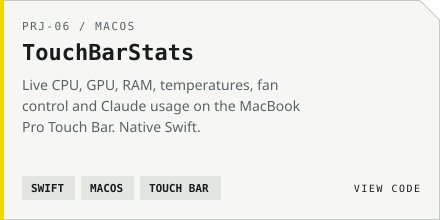</picture></a>

**Code:** [2.4 GHz Scanner](https://github.com/JohnTenno/nRF52840-2.4GHz-Spectrum-Analyzer) · [Lighthouse Manager](https://github.com/JohnTenno/lighthouse-manager-quest) · [ESP32 Guitar](https://github.com/JohnTenno/ESP32-GUITARHERO-UART) · [claude-watchOS](https://github.com/JohnTenno/claude-watchOS) · [TouchBarStats](https://github.com/JohnTenno/TouchBarStats) · [livewall](https://github.com/JohnTenno/livewall-macos)

<picture><source media="(prefers-color-scheme: dark)" srcset="./imgs/endfield/dark/stack.svg">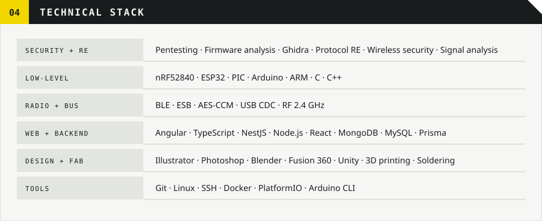</picture>

<picture><source media="(prefers-color-scheme: dark)" srcset="./imgs/endfield/dark/background.svg">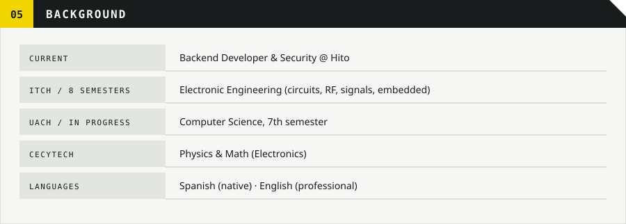</picture>

<picture><source media="(prefers-color-scheme: dark)" srcset="./imgs/endfield/dark/s-contact.svg"></picture>

  <a href="mailto:johntenno117@hotmail.com"><picture><source media="(prefers-color-scheme: dark)" srcset="./imgs/endfield/dark/c-email.svg"></picture></a>
  <a href="https://www.linkedin.com/in/jonathan-gandara-1191aa267/"><picture><source media="(prefers-color-scheme: dark)" srcset="./imgs/endfield/dark/c-linkedin.svg"></picture></a>
  <a href="https://discordapp.com/users/583377862870958085"><picture><source media="(prefers-color-scheme: dark)" srcset="./imgs/endfield/dark/c-discord.svg"></picture></a>

